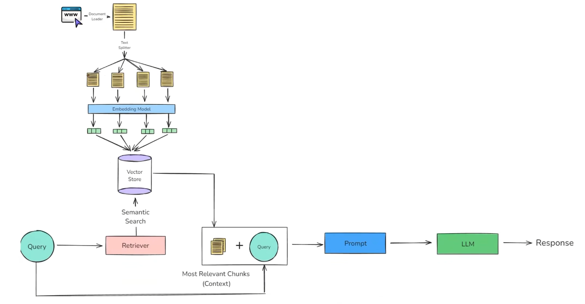

# RAG Revision Notes (cheat sheet)

# RAG Pipeline



Short on purpose. The detailed theory (flow diagrams, every function, trade-offs) lives in the **docstring at the top of each code file**; see section 9.

---

## 1. RAG in one line

**Retrieval-Augmented Generation** = before asking the LLM, find the relevant pieces of *my* documents and paste them into the prompt.
An LLM only knows its training data; without RAG it fills gaps with plausible guesses (**hallucination**). With RAG it answers from my text (**grounding**): open-book vs closed-book exam.

## 2. The pipeline

```
INDEXING (once)                                        QUERYING (every question)
load → chunk → embed → store (id, vector, metadata)    question → embed (same model) → search top-k
                                                         → prompt = rules + context + question → LLM → answer
```

> "I split documents into chunks, embed each chunk and the question with the same model, retrieve the top-k most similar chunks, and put them in a prompt that says: answer only from this context, otherwise say I don't know. That reduces hallucination but doesn't eliminate it."

## 3. Concepts, one line each

| Concept | One line |
|---|---|
| **Embedding** | text → fixed-length vector (nomic-embed-text: **768** numbers); similar meaning → nearby vectors. Deterministic → cacheable. Query and docs must use the **same model**. nomic needs `search_query:` / `search_document:` prefixes. |
| **Cosine similarity** | `dot(a,b) / (len(a)·len(b))`: direction, not length. Only the **ranking** within one run matters, not the absolute number. |
| **Chunking** | one vector can't hold a whole document (meaning gets averaged away). Too big = blurry, too small = no context. Aim for **one complete idea** (~500–1500 chars), with ~10–15% **overlap**. |
| **Splitters** | all "biggest separator first, merge up to `chunk_size`". Only the **separators** (paragraphs, headings, code, sentences) and the **length unit** (chars vs tokens) change. `split_documents` keeps metadata, `split_text` doesn't. |
| **Document** | `Document(page_content, metadata)`, the one shape every LangChain piece speaks. My dicts must be converted before `add_documents`. |
| **Metadata** | source, page, timestamp, category → citations ("page 112", "at 4:35") and **filters** (`WHERE`). |
| **Vector store** | stores (id, vector, metadata) and finds nearest neighbours (the capability). |
| **Vector database** | a vector store + database parts: persistence, CRUD, filters, scaling, auth (Pinecone, Qdrant, pgvector). FAISS = store, Pinecone = database. |
| **Index** (Pinecone) | like a table: fixed `dimension` (= embedding size, 768) + `metric` (cosine). Created once. |
| **Upsert + ids** | same id overwrites (`INSERT … ON CONFLICT DO UPDATE`) → re-runs don't duplicate. No ids → random UUIDs → duplicates. Re-chunking leaves old ids as **orphans**. |
| **ANN index** | approximate nearest neighbour (HNSW…): fast at millions of vectors, trades exactness for speed. |
| **Retriever** | search-only interface: `invoke(question) → [Document]`, settings fixed once. Library = vector store; helper with fixed instructions = retriever. Swappable, plugs into chains. |
| **Relevance score** | for cosine, LangChain's `score_threshold` uses `(raw + 1) / 2`, not raw cosine. `EmbeddingsFilter` uses **raw** cosine. |
| **Eventual consistency** | new vectors aren't searchable instantly (like replica lag). |

## 4. Which retriever, when? The 4 questions

```
START: plain vector retriever (k=3–5)      ← always the baseline
 1. Users type exact words (codes, IDs, names)?        → + BM25 = Ensemble (hybrid, merged by rank: RRF)
 2. Users phrase things differently from the docs?     → + Multi-query (LLM writes 3 versions, merge)
 3. Many sources, question about one?                  → + metadata filter (I know which) / Self-query (LLM writes the filter)
 4. Chunk size wrong?  too small → Parent document (search small, return big)
                       too big   → Compression (EmbeddingsFilter, then LLMChainExtractor if needed)
                       duplicates → MMR
All "no" → the plain retriever IS the right answer.
```

| Piece | Extra cost per question |
|---|---|
| filter, MMR, score threshold, BM25, parent doc, EmbeddingsFilter | cheap / ~free |
| multi-query, self-query | **+1 LLM call** (before search) |
| LLM compression (extractor / filter) | **+k LLM calls** (after search) |

| My project | → Retriever |
|---|---|
| store policy (5 paragraphs) | plain + score threshold |
| company docs (codes + varied wording) | ensemble (+ multi-query if recall is low) |
| YouTube chat | MMR + `video_id` filter, **no** compression (context already small) |
| 200-page handbook | ensemble + parent document + filter |

Big documents: chunk → **many rows** → search the chunks; metadata ties each chunk to its source/page. Pinecone metadata limit 40 KB/record → keep chunks small.

## 5. Measuring: recall vs precision

- **Recall** = right found / right total → *did I find everything?* Bad → missing facts.
- **Precision** = right returned / total returned → *is it all relevant?* Bad → noise, traps.
- **Recall@k / hit rate**: is the right chunk in the top k? Averaged over a test set.
- Multi-query, hybrid, bigger k → recall. Compression, threshold, filters, MMR → precision. **Find widely, then clean up.**
- In RAG, **recall matters more**: a chunk never retrieved can't be fixed later.
- Example: 4 right docs, returned 3 of which 2 are right → recall 0.5, precision 0.67.
- **Measure, don't guess:** baseline → ~10–20 test questions → print what was retrieved → fix one thing → re-measure.

## 6. My version → production (scaling)

| My version | Limit | Fix |
|---|---|---|
| re-embed every run | slow | store vectors; cache embeddings by content hash |
| Python cosine loop | O(N) | ANN index in a vector DB |
| `split("\n\n")` | messy docs | size-based + overlap, structure-aware splitters |
| always top-k | junk for unrelated questions | score threshold, reranker |
| vectors only | misses exact terms | hybrid (BM25 + vector) |
| "looks right" | can't tell if a change helps | eval set, recall@k |
| no sources | can't verify | metadata + citations |

## 7. Interview Q&A

- **RAG vs fine-tuning?** RAG supplies **facts** (update docs instantly, cite sources, cheaper); fine-tuning changes **style/behaviour**.
- **Why chunk?** whole-doc embeddings dilute facts and waste context. Size = precision vs context trade-off; tune with an eval set.
- **Why the same embedding model?** different models = different vector spaces; comparing them is meaningless.
- **Choosing k?** recall vs noise/cost; add a threshold; measure recall@k.
- **Reduce hallucination?** good retrieval, "only from context / say I don't know", threshold, cite chunks, test with unanswerable questions. Reduces, never eliminates.
- **Vector store vs vector database?** capability (store + nearest neighbours) vs a full database around it (persistence, CRUD, filters, scaling, auth).
- **Multi-query?** improves recall when users word things differently; costs 1 LLM call + N× searches; measure recall@k to justify it.
- **Hybrid search?** vectors understand meaning, BM25 matches exact terms; they fail in opposite places; merge by rank (RRF) because their scores aren't comparable.
- **How do you know RAG is good?** eval set: retrieval (recall@k, hit rate) + generation (correctness, faithfulness). Change one variable at a time.

## 8. Gotchas I hit

**Python**
- `"missing argument X"` but I passed X → called a method on the **class**: add `()` → `YouTubeTranscriptApi().fetch(...)`. Never pass `self` yourself; `self` = the object before the dot.
- Never bare `except:`: it turned a code bug into "no captions". Use `except Exception as e: print(type(e).__name__, e)`.
- `obj.text` (objects) vs `d["text"]` (dicts); unsure → `print(type(x))`.
- `for chunk in some_string` loops over **characters** (would have stored 23,160 one-letter rows).
- `KeyError` → that key isn't there: `print(d.keys())`.
- Values from a DB/API can change type: Pinecone returns `54` as `54.0` → `int(...)` before `:02d`.
- `No module named X` → wrong venv (prompt must show `(.venv)`, not `(.venv314)`); check `sys.executable`.
- Read the **last line** of a traceback, then the first line in *my* file. File paths are relative to where I run the command.
- Tutorials go out of date → check the installed signature: `help(fn)` / `inspect.signature(fn)`.

**LangChain / Pinecone**
- `pinecone.Pinecone` = client (create/delete indexes). `PineconeVectorStore` = LangChain (add/search). Never import `Pinecone` from `langchain_pinecone` (old alias of the vector store).
- `load_dotenv()` takes no argument; `os.getenv("KEY")` reads it.
- `add_documents` needs `Document`s, not dicts (`'dict' object has no attribute 'page_content'`).
- `ContextualCompressionRetriever(base_retriever=…, base_compressor=…)`; pydantic `Field required` names the missing fields.
- Pinecone stores text in `metadata["text"]`; the console shows metadata, vectors are there (`index.fetch`).
- BM25 default tokeniser is `split()`: `"ExpenseHub?"` ≠ `"ExpenseHub"` → `preprocess_func` lowercase + words only.
- Self-query: `ImportError: DatabricksVectorSearch` → pass `structured_query_translator=PineconeTranslator()`; see the query with `verbose=True` + INFO logging.
- `langchain-pinecone` needs Python **< 3.14** (on 3.14 pip fell back to an ancient version → numpy build failure).

## 9. Where to read more (docstring at the top of each file)

| Topic | File |
|---|---|
| hand-built RAG (cosine, chunking, search) | `concepts/` |
| loaders (text, PDF, Docling, directory, web) | `langchain/loaders/*.py` |
| splitters (character, recursive, overlap, markdown, code, token) | `langchain/text_split/*.py` |
| indexing into Pinecone | `langchain/vector_store/vector_store.py` |
| search + retriever (similarity, threshold, filter, MMR) | `langchain/vector_store/vector_search.py` |
| multi-query | `langchain/retrievers/multi_query_retriever.py` |
| contextual compression (LLM) | `langchain/retrievers/contextual_compression_retriever.py` |
| embeddings filter pipeline (no LLM) | `langchain/retrievers/embeddings_filter_retriever.py` |
| BM25 / ensemble (hybrid) | `langchain/retrievers/bm25_retriever.py`, `ensemble_retriever.py` |
| parent document | `langchain/retrievers/parent_document_retriever.py` |
| self-query | `langchain/retrievers/self_query_retriever.py` |
| YouTube chat (transcript, time chunks, filter) | `youtube-chat-rag/youtube-chat-rag.py` |
